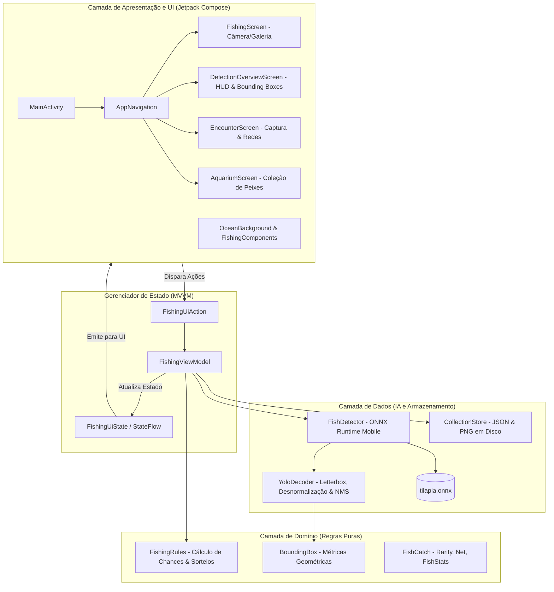
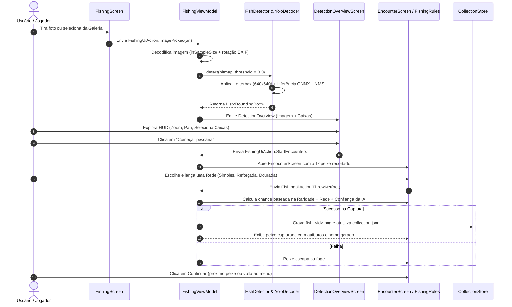

# 🐟 Documentação Completa e Mapeamento do Projeto Fish Finder

> **Objetivo do Documento:** Guia completo e didático de explicação de todos os arquivos, funções e arquitetura do projeto **Fish Finder**. Elaborado em Português do Brasil para estudo aprofundado e preparação para apresentação acadêmica/banca.

---

## 1. Visão Geral do Projeto

### O que é o Fish Finder?
O **Fish Finder** é um aplicativo Android nativo desenvolvido em **Kotlin** com **Jetpack Compose** que combina **Visão Computacional On-Device** (inteligência artificial executada 100% localmente no celular) com uma **mecânica de jogo e coleção (gamificação)**.

### A Ideia Central
Em vez de ser apenas um leitor de imagens estático e sem engajamento, o Fish Finder transforma fotos reais de tanques ou aquários em uma experiência interativa:
1. O usuário tira uma foto com a **câmera** ou escolhe uma da **galeria**.
2. O modelo de inteligência artificial (**YOLOv8** exportado em formato **ONNX**) analisa a imagem diretamente na CPU/GPU do celular em milissegundos, sem enviar fotos para a nuvem (garantindo privacidade total e funcionamento offline).
3. O app exibe uma tela de **Auditoria HUD com Bounding Boxes**, mostrando exatamente onde cada peixe (tilápia) foi detectado, seu grau de confiança e métricas geométricas (área, dimensões e centróide).
4. Cada peixe detectado é recortado e vira um **"Encontro de Pesca"**: o jogador escolhe entre três redes (Simples, Reforçada, Dourada) para tentar capturá-lo.
5. **Integração IA + Game:** Quanto maior a confiança da IA na detecção (peixe mais nítido na foto), **maior a chance de captura**!
6. Os peixes capturados ganham atributos (Força, Velocidade, Resistência, Tamanho) e são guardados no **Aquário Virtual** (com persistência local em JSON e recortes em PNG).

---

## 2. Diagrama de Arquitetura e Fluxo de Dados

O projeto adota o padrão recomendado pelo Google: **Clean Architecture** aliada ao **MVVM (Model-View-ViewModel)** com **UDF (Unidirectional Data Flow)**.

---

## 3. Fluxo de Vida de uma Captura (Passo a Passo)

---

## 4. Mapeamento e Explicação de Todos os Arquivos e Funções

Abaixo está o detalhamento de cada arquivo do projeto, explicando sua finalidade, suas classes e todas as suas funções de maneira clara e direta.

---

### 📂 Raiz do Projeto e Configurações de Build

#### 1. `build.gradle.kts` (Raiz)
* **O que é:** Arquivo mestre de configuração do Gradle no nível do projeto.
* **O que faz:** Declara os plugins fundamentais do Android e do Kotlin Compose sem aplicá-los imediatamente (`apply false`), delegando sua aplicação aos submódulos.

#### 2. `settings.gradle.kts`
* **O que é:** Configurações de inicialização do projeto Gradle.
* **O que faz:** Define os repositórios oficiais de dependências (`google()`, `mavenCentral()`), o gerenciador de toolchains Java (Foojay) e inclui o módulo principal `:app`.

#### 3. `gradle/libs.versions.toml`
* **O que é:** Catálogo de versões de dependências do Gradle (Version Catalog).
* **O que faz:** Centraliza as versões de bibliotecas e plugins em um só lugar.
  - `onnxruntime = "1.20.0"`: Biblioteca para inferência neural on-device.
  - `composeBom = "2026.02.01"`: Bill of Materials do Jetpack Compose.
  - `kotlin = "2.2.10"` e `agp = "9.4.1"`: Versões do compilador Kotlin e Android Gradle Plugin.

#### 4. `app/build.gradle.kts`
* **O que é:** Script de build específico do módulo Android `:app`.
* **O que faz:**
  - Configura o `compileSdk` e `targetSdk` (versão 37) e `minSdk = 24` (Android 7.0+).
  - Habilita o **Jetpack Compose** (`buildFeatures { compose = true }`).
  - **Destaque Importante:** Na seção `sourceSets`, mapeia a pasta raiz `models/` para os `assets` do aplicativo (`getByName("main").assets.srcDir(rootProject.file("models"))`), permitindo empacotar o modelo `tilapia.onnx` sem duplicá-lo no repositório.
  - Declara as dependências de runtime: `onnxruntime-android`, `material3`, `activity-compose`, `core-ktx`, etc.

#### 5. `AndroidManifest.xml`
* **O que é:** Manifesto da aplicação Android.
* **O que faz:**
  - Declara a `MainActivity` como atividade principal e inicializadora (`LAUNCHER`).
  - Configura o tema global `@style/Theme.Fish_finder`.
  - Configura o `FileProvider` (`androidx.core.content.FileProvider`), necessário para compartilhar com segurança o arquivo de foto temporário entre o aplicativo e a câmera nativa do sistema operacional.

#### 6. `app/src/main/res/xml/file_paths.xml`
* **O que é:** Configuração de diretórios acessíveis pelo `FileProvider`.
* **O que faz:** Mapeia a pasta de cache `photos/` para criação segura dos arquivos temporários de foto da câmera (`capture.jpg`).

#### 7. `models/tilapia.onnx`
* **O que é:** Modelo neural convolucional de detecção de objetos (YOLO).
* **O que faz:** Rede treinada para detectar tilápias e peixes em imagens, convertida para o padrão aberto ONNX (*Open Neural Network Exchange*), pronta para execução em alta velocidade em hardware móvel.

---

### 📂 Ponto de Entrada (Entrypoint)

#### 8. `MainActivity.kt` (`com.example.fish_finder.MainActivity`)
* **O que é:** A única `Activity` da aplicação (Single Activity Architecture).
* **Funções:**
  - `onCreate(savedInstanceState: Bundle?)`:
    - Chama `enableEdgeToEdge()` para visual imersivo (conteúdo sob as barras de status e navegação).
    - Inicializa a árvore de componentes Compose através de `setContent { ... }`.
    - Envolve o app no tema `Fish_finderTheme(darkTheme = false)`.
    - Coleta o estado reativo do ViewModel via `viewModel.uiState.collectAsState()`.
    - Renderiza o composable raiz `AppNavigation`, passando o estado e a ponte de ações `viewModel::onAction`.
  - `AppPreview()`: Função composable com anotação `@Preview` para permitir pré-visualização no Android Studio.

---

### 📂 Camada de Domínio (`domain/`)

A camada de domínio contém os modelos fundamentais de negócio e as regras do jogo. É código puro em Kotlin, independente de frameworks do Android, o que garante facilidade de teste unitário.

#### 9. `domain/model/BoundingBox.kt`
* **O que é:** Modelo de dados que representa uma caixa delimitadora identificada pela IA.
* **Propriedades:**
  - `boxId: Int`: Identificador numérico único da caixa na sessão (ex: 1, 2, 3...).
  - `classLabel: String`: Nome da classe detectada (ex: `"tilapia"`).
  - `confidence: Float`: Grau de certeza da IA (entre 0.0 e 1.0).
  - `xMin: Float`, `yMin: Float`: Coordenadas do canto superior esquerdo da caixa (em pixels da foto original).
  - `widthPx: Float`, `heightPx: Float`: Largura e altura da caixa (em pixels).
  - `centroidX: Float`, `centroidY: Float`: Centróide geométrico calculado automaticamente como $x_{min} + \frac{largura}{2}$ e $y_{min} + \frac{altura}{2}$.
* **Propriedades Calculadas:**
  - `areaPx`: Área retangular da caixa ($largura \times altura$).
  - `formattedDimensions`: String amigável da largura $\times$ altura (ex: `"220.00 × 180.00 px"`).
  - `formattedCentroid`: String amigável das coordenadas do centróide (ex: `"(310.00, 290.00) px"`).
  - `formattedArea`: String amigável da área em pixels quadrados (ex: `"39600.00 px²"`).
  - `formattedConfidence`: Porcentagem inteira da confiança (ex: `"92%"`).

#### 10. `domain/model/FishCatch.kt`
* **O que é:** Entidades e enumerações que definem o sistema de captura e atributos dos peixes.
* **Componentes:**
  - `enum class Rarity`:
    - `COMUM`: peso 60, chance base de captura 65%.
    - `INCOMUM`: peso 25, chance base de captura 50%.
    - `RARO`: peso 11, chance base de captura 35%.
    - `LENDARIO`: peso 4, chance base de captura 20%.
  - `enum class Net`:
    - `SIMPLES`: multiplicador de captura 1.0x.
    - `REFORCADA`: multiplicador de captura 1.4x.
    - `DOURADA`: multiplicador de captura 1.8x.
  - `data class FishStats`: Guarda 4 atributos inteiros do peixe: `power` (Força), `speed` (Velocidade), `stamina` (Resistência) e `size` (Tamanho).
  - `data class CaughtFish`: Entidade do peixe guardado no aquário: `id` (UUID), `name` (nome gerado), `rarity` (Raridade), `stats` (Atributos), `caughtAt` (timestamp em milissegundos) e `imagePath` (caminho local do arquivo PNG recortado).

#### 11. `domain/game/FishingRules.kt`
* **O que é:** Regras matemáticas e mecânicas puras do minijogo de pesca. Todas as funções recebem uma instância de `kotlin.random.Random`, permitindo testes determinísticos com sementes controladas.
* **Funções:**
  - `rollRarity(rng: Random): Rarity`: Realiza um sorteio ponderado baseado nos pesos das raridades (soma = 100).
  - `catchChance(rarity: Rarity, net: Net, confidence: Float): Float`:
    - **A grande sacada do projeto:** Calcula a probabilidade final de captura com a fórmula:
      $$\text{Chance} = \text{baseCatchRate} \times \text{multiplier} \times (0.6 + 0.4 \times \text{confiança})$$
    - Isso significa que fotos nítidas com alta confiança de IA tornam o peixe mais fácil de capturar! O valor é limitado no intervalo de $[0.05, 0.95]$ (sempre há entre 5% e 95% de chance).
  - `fleeChance(rarity: Rarity): Float`: Calcula a probabilidade de o peixe fugir após o jogador errar uma tentativa ($0.10 + 0.05 \times \text{raridade}$). Peixes lendários fogem com maior facilidade.
  - `newFish(id, imagePath, rarity, now, rng): CaughtFish`: Cria a instância do peixe com nome procedimental (combina substantivos como "Tilápio", "Escamado" com adjetivos como "Veloz", "Dourado") e sorteia seus 4 atributos com faixas mínimas e máximas determinadas pela sua raridade.

---

### 📂 Camada de Dados (`data/`)

Responsável pela inferência de IA com ONNX Runtime e pela persistência local de dados em disco.

#### 12. `data/detector/FishDetector.kt`
* **O que é:** Mecanismo responsável pelo ciclo de vida da sessão ONNX Runtime e pré-processamento de imagem para a rede neural. Implementa `AutoCloseable`.
* **Funções:**
  - `constructor(context: Context)`: Cria o `OrtEnvironment` e inicializa a sessão `OrtSession` carregando os bytes de `tilapia.onnx` diretamente da pasta de assets.
  - `detect(bitmap: Bitmap, threshold: Float = 0.3f): List<BoundingBox>`:
    1. **Letterboxing:** Calcula a escala proporcional e o preenchimento (*padding*) para ajustar qualquer formato de imagem à resolução exata exigida pelo modelo ($640 \times 640$ pixels) sobre um fundo cinza neutro RGB(114, 114, 114).
    2. **Normalização de Pixels:** Extrai os canais R, G e B de cada pixel e converte os valores inteiros $[0, 255]$ para ponto flutuante $[0.0, 1.0]$ no formato planar NCHW: $[1, 3, 640, 640]$.
    3. **Inferência:** Cria um `OnnxTensor` a partir do buffer float e executa `session.run(...)`.
    4. **Pós-processamento:** Passa a matriz de tensores gerada para o `YoloDecoder.decode(...)` para decodificar as caixas e aplicar o NMS.
  - `close()`: Fecha a sessão do ONNX Runtime e libera memória nativa do dispositivo.

#### 13. `data/detector/YoloDecoder.kt`
* **O que é:** Decodificador matemático que transforma a saída bruta do YOLO em caixas utilizáveis.
* **Funções:**
  - `decode(output, scale, padX, padY, imageWidth, imageHeight, threshold, iouThreshold = 0.45f): List<BoundingBox>`:
    1. Percorre as âncoras da saída do modelo `[cx, cy, w, h, score]`.
    2. Descarta âncoras cujo score de confiança seja inferior ao `threshold` estipulado (ex: 0.3).
    3. Converte as coordenadas do centro $(cx, cy)$ e dimensões $(w, h)$ para os vértices $(x_1, y_1)$ e $(x_2, y_2)$.
    4. Remove o deslocamento do letterbox (`padX`, `padY`) e divide pela escala (`scale`), revertendo as coordenadas para a resolução original da foto tirada pelo usuário.
    5. **Algoritmo NMS (Non-Maximum Suppression):** Ordena os candidatos da maior para a menor confiança e elimina caixas sobrepostas cuja sobreposição (IoU) seja superior a 0.45, evitando que um único peixe gere múltiplas caixas duplicadas.
    6. Retorna as caixas finais numeradas com IDs incrementais (1, 2, 3...).
  - `iou(a: BoundingBox, b: BoundingBox): Float`:
    - Calcula a **Interseção sobre União (Intersection over Union)**:
      $$\text{IoU} = \frac{\text{Área da Interseção}}{\text{Área}(A) + \text{Área}(B) - \text{Área da Interseção}}$$
    - Retorna $0.0$ se não houver intersecção entre as duas caixas.

#### 14. `data/storage/CollectionStore.kt`
* **O que é:** Gerenciador de persistência local em arquivos no diretório privado do aplicativo (`app.filesDir`), sem necessidade de banco de dados pesado.
* **Funções:**
  - `imagePathFor(id: String): String`: Retorna o caminho absoluto do arquivo PNG correspondente àquele ID (`fish_<id>.png`).
  - `load(): List<CaughtFish>`: Lê o arquivo `collection.json`, decodifica o `JSONArray` e retorna a lista de peixes capturados. Se o arquivo ainda não existir, retorna uma lista vazia.
  - `add(fish: CaughtFish, crop: Bitmap)`:
    1. Salva o recorte de imagem do peixe (`crop`) em formato PNG comprimido na pasta local do app.
    2. Lê a lista atual de peixes, adiciona o novo peixe e regrava o arquivo `collection.json`.
  - `CaughtFish.toJson()`: Função de extensão privada que converte um `CaughtFish` em `JSONObject`.
  - `JSONObject.toFish()`: Função de extensão privada que reconstrói um `CaughtFish` a partir de um `JSONObject`.

---

### 📂 Camada de Apresentação e Estado (`presentation/`)

Faz a gestão reativa do estado da interface seguindo as diretrizes do **UDF (Fluxo Unidirecional de Dados)**.

#### 15. `presentation/state/FishingUiState.kt`
* **O que é:** Definição imutável do estado e das ações possíveis da UI.
* **Classes e Modelos:**
  - `class Encounter`: Representa um peixe pronto para o duelo de captura (possui o `crop: Bitmap` recortado da foto original, a `confidence`, a `rarity` sorteada e o `boxId`).
  - `data class ScanSummary`: Resumo da análise da imagem (total de peixes encontrados e confiança média formatada em porcentagem).
  - `data class DetectionOverview`: Guarda a imagem inteira (`image: Bitmap`) e a lista de caixas (`boxes: List<BoundingBox>`) para a tela de HUD com Bounding Boxes.
  - `sealed interface ThrowResult`: Modela os três desfechos possíveis do arremesso da rede:
    - `Missed`: A rede errou ou o peixe escapou momentaneamente (pode tentar de novo).
    - `Fled`: O peixe fugiu definitivamente daquele encontro.
    - `Caught(val fish: CaughtFish)`: Captura bem-sucedida com o peixe registrado.
  - `data class FishingUiState`: O estado global observado pela interface:
    - `isScanning`: Booleano que indica se a IA está processando uma foto no momento.
    - `message`: Mensagem informativa de erro ou alerta na tela.
    - `summary`: Instância de `ScanSummary`.
    - `detectionOverview`: Quando não é nulo, aciona a tela de visão geral das caixas da IA.
    - `encounters`: Fila de peixes detectados aguardando captura.
    - `currentEncounter`: Propriedade calculada (`encounters.firstOrNull()`) que indica o peixe ativo no duelo.
    - `isThrowing`: Booleano que aciona a animação de lançamento da rede.
    - `result`: Desfecho do último arremesso (`ThrowResult`).
    - `collection`: Lista atual de todos os peixes no aquário.
  - `sealed interface FishingUiAction`: Ações disparadas pelos botões da interface:
    - `ImagePicked(val uri: Uri)`: Foto tirada na câmera ou selecionada na galeria.
    - `ThrowNet(val net: Net)`: Jogador lançou uma rede específica.
    - `NextEncounter`: Passa para o próximo peixe da fila após captura/fuga.
    - `StartEncounters`: Usuário encerrou a visualização do HUD e iniciou a pescaria individual.
    - `DismissDetectionOverview`: Usuário cancelou a visualização para tirar outra foto.

#### 16. `presentation/viewmodel/FishingViewModel.kt`
* **O que é:** O cérebro da camada de apresentação (herda de `AndroidViewModel`). Mantém o estado da tela vivo mesmo durante rotações de tela e gerencia as coroutines assíncronas.
* **Funções:**
  - `init`: Inicializa o ViewModel carregando a coleção salva no `CollectionStore` através de uma coroutine em `Dispatchers.IO`.
  - `onAction(action: FishingUiAction)`: Centralizador que recebe as ações dos Composables e chama os métodos de negócio correspondentes.
  - `scan(uri: Uri)`:
    - Atualiza `isScanning = true`.
    - Executa em segundo plano (`Dispatchers.Default`):
      1. Decodifica e rotaciona a imagem (`decode(uri)`).
      2. Executa a inferência neural (`detector.detect(bitmap)`).
      3. Gera o `ScanSummary`.
      4. Recorta até 10 peixes para a fila de `encounters` (`crop(bitmap, box)`).
    - Atualiza o estado da UI com o `detectionOverview` e os `encounters`.
  - `throwNet(net: Net)`:
    - Ativa a flag `isThrowing = true` e aguarda 1500ms (`delay`) para a animação da rede.
    - Consulta `FishingRules.catchChance(...)`. Se capturado, gera o novo peixe, persiste no disco via `store.add(...)` em `Dispatchers.IO` e atualiza o estado com `ThrowResult.Caught`.
    - Se falhou, consulta `FishingRules.fleeChance(...)` para definir se o peixe fugiu (`ThrowResult.Fled`) ou apenas escapou daquela tentativa (`ThrowResult.Missed`).
  - `decode(uri: Uri): Bitmap?`:
    - Decodifica a imagem a partir da URI com leitura prévia de limites (`inJustDecodeBounds`).
    - Calcula o `inSampleSize` para reduzir imagens gigantescas para no máximo 2048px, prevenindo estouro de memória (`OutOfMemoryError`).
    - Lê os metadados EXIF (`ExifInterface`) e aplica a rotação necessária (ex: fotos tiradas na vertical em alguns aparelhos Samsung/Motorola).
  - `crop(source: Bitmap, box: BoundingBox): Bitmap`:
    - Faz o recorte da caixa delimitadora adicionando 10% de margem ao redor do peixe para dar contexto visual e evitar cortes bruscos, limitando os vértices às bordas reais da foto.
  - `onCleared()`: Executado quando a Activity é finalizada; fecha com segurança a sessão do detector (`detector.close()`).

---

### 📂 Camada de Interface do Usuário (`ui/`)

Desenvolvida 100% em **Jetpack Compose** declarativo, com animações ricas em Canvas e suporte a gestos multitoque.

#### 17. `ui/navigation/AppNavigation.kt`
* **O que é:** Controlador visual de navegação da interface.
* **Componentes:**
  - `enum class AppDestination`: Abas da barra inferior (`FISH` com ícone de lupa e `AQUARIUM` com ícone de estrela).
  - `AppNavigation(state, onAction, modifier)`:
    - **Lógica de Prioridade de Telas:**
      1. Se `state.detectionOverview != null`, renderiza em tela cheia a tela de HUD e Bounding Boxes (`DetectionOverviewScreen`).
      2. Se `state.currentEncounter != null`, renderiza em tela cheia a tela de duelo e arremesso de rede (`EncounterScreen`).
      3. Caso contrário, exibe o `Scaffold` com a `NavigationBar` inferior, alternando entre a `FishingScreen` (pescar) e a `AquariumScreen` (aquário).

#### 18. `ui/screens/fishing/FishingScreen.kt`
* **O que é:** Tela principal de entrada. O usuário escolhe capturar uma foto com a câmera ou importar da galeria.
* **Componentes e Funções:**
  - `rememberLauncherForActivityResult(ActivityResultContracts.TakePicture())`: Contrato nativo moderno do Android para acionar a câmera com armazenamento seguro no arquivo gerado pelo `FileProvider`.
  - `rememberLauncherForActivityResult(ActivityResultContracts.PickVisualMedia())`: Photo Picker nativo moderno do Android para escolher fotos da galeria sem precisar de permissões invasivas de armazenamento.
  - Exibe o botão de Câmera (dourado) e de Galeria (branco), além de indicadores visuais de progresso quando a IA está analisando (`CircularProgressIndicator`) e o contador de peixes já capturados.

#### 19. `ui/screens/fishing/DetectionOverviewScreen.kt`
* **O que é:** A tela de **Auditoria Visual da IA e Bounding Boxes**. É o coração técnico da demonstração de Visão Computacional.
* **Destaques Técnicos e Funções:**
  - `BOX_PALETTE` & `colorForBox(boxId)`: Lista de cores vibrantes (Azul, Verde-água, Laranja, Roxo, Dourado) atribuídas ciclicamente a cada caixa detectada.
  - `BackHandler`: Trata o botão "Voltar" do celular para retornar à tela anterior sem fechar o app.
  - **Controle de Gestos Avançado:**
    - `detectTransformGestures`: Permite pinça de **Zoom** ($1\times$ a $4\times$) e **Pan** (arrastar a imagem com o dedo) preservando o aspect ratio exato da imagem.
    - `detectTapGestures`: Suporta **toque duplo** para alternar rapidamente entre zoom $1\times$ e $2\times$, e **toque simples** em qualquer caixa da tela para inspecionar seus detalhes.
  - **Renderização Gráfica em Canvas:**
    - Desenha o retângulo semi-transparente e a borda sólida da caixa delimitadora.
    - **Cantoneiras HUD:** Desenha cantoneiras táticas nos 4 cantos da caixa, dando um visual futurista/científico de radar marinho.
    - **Centróide Geométrico:** Desenha círculos concêntricos exatos na coordenada $(x_c, y_c)$.
    - **Etiqueta (Badge):** Renderiza uma tag suspensa contendo `#ID Classe Confiança%` usando a API `TextMeasurer` do Compose.
  - **Carrossel Horizontal:** Barra de chips rolável na parte inferior para seleção rápida dos peixes detectados com indicação de confiança e métricas (largura $\times$ altura e área em px²).
  - Botão principal: "Começar pescaria (N peixes)".

#### 20. `ui/screens/fishing/EncounterScreen.kt`
* **O que é:** Tela de duelo individual para captura do peixe recortado.
* **Destaques e Funções:**
  - `wobble` e `ringAngle`: Animações contínuas criadas com `rememberInfiniteTransition` que giram um anel tracejado ao redor do peixe e balançam a rede de pesca durante o arremesso.
  - `fishScale`: Animação suave que reduz a escala do peixe quando a rede o captura.
  - `NetButton`: Botões para as 3 redes (Simples, Reforçada, Dourada), exibindo a chance real calculada em porcentagem (ex: "65%", "91%").
  - Quando o peixe é capturado, exibe o nome gerado e as barras de atributos (`StatBars`).

#### 21. `ui/screens/fishing/AquariumScreen.kt`
* **O que é:** Galeria/Aquário onde o jogador consulta todos os peixes já capturados.
* **Componentes e Funções:**
  - `LazyVerticalGrid(columns = GridCells.Fixed(2))`: Grade de 2 colunas com rolagem vertical suave e carregamento sob demanda.
  - `FishCard(fish: CaughtFish)`: Cartão de exibição de cada peixe. Decodifica a imagem PNG salva localmente de forma otimizada com `remember(fish.imagePath)`, exibe o nome, a tag de raridade e as 4 barras de atributos com a cor da raridade.

#### 22. `ui/components/fishing/FishingComponents.kt`
* **O que é:** Componentes visuais utilitários e reutilizáveis.
* **Funções:**
  - `Rarity.color(): Color`: Mapeia cada raridade para sua cor temática (Cinza, Verde, Azul, Dourado).
  - `Net.color(): Color`: Mapeia cada tipo de rede para sua tonalidade.
  - `RarityChip(rarity)`: Badge arredondado com o nome da raridade em caixa alta.
  - `NetIcon(color, size)`: Ícone vetorial customizado desenhado puramente com linhas geométricas no `Canvas`, representando a malha entrelaçada de uma rede de pesca.
  - `StatBars(stats, accent)`: Constrói a lista vertical com as 4 barras de atributos.
  - `StatRow(label, value, accent, labelColor)`: Linha individual com o rótulo do atributo, uma `LinearProgressIndicator` com cantos arredondados e o valor numérico de 0 a 100.

#### 23. `ui/components/fishing/OceanBackground.kt`
* **O que é:** Plano de fundo dinâmico oceânico presente em todas as telas principais do aplicativo.
* **Destaques:**
  - `class Bubble`: Estrutura interna que guarda a posição horizontal $X$, raio, velocidade e deslocamento de fase de cada bolha.
  - Utiliza um `Brush.verticalGradient` combinando três tons de azul profundo (`OceanLight`, `OceanMid`, `OceanDeep`).
  - Desenha 16 bolhas animadas que sobem pela tela de forma suave e infinita através de cálculo modular (`% 1f`), sem solavancos nem travamentos na transição.

#### 24. `ui/theme/Color.kt`
* **O que é:** Paleta de cores do Design System do aplicativo.
* **Categorias:**
  - Cores técnicas para o Light Mode: `AppBackground`, `AppSurface`, `AppPrimary`, `TextPrimary`, etc.
  - Cores para visualização técnica de Bounding Boxes: `BoundingBoxColor1` a `BoundingBoxColor4`.
  - Cores temáticas do oceano: `OceanDeep` (#04304D), `OceanMid` (#0B6E99), `OceanLight` (#31B6C9), `GoldAccent` (#FFC53D).
  - Cores das raridades: `RarityCommon`, `RarityUncommon`, `RarityRare`, `RarityLegendary`.

#### 25. `ui/theme/Theme.kt`
* **O que é:** Configuração do tema Material Design 3.
* **Destaque:** Configura estritamente o **Light Mode** por especificação de projeto e usa `WindowCompat.getInsetsController` para garantir que as barras de navegação e de status do Android fiquem com fundo claro e ícones escuros legíveis.

#### 26. `ui/theme/Type.kt`
* **O que é:** Definições tipográficas do Compose (`Typography`).
* **Destaque:** Define a hierarquia de fontes (`headlineLarge`, `titleMedium`, `bodyMedium`) e estilos especializados para telemetria (`TelemetryValueStyle` em fonte Monospace para leitura técnica de coordenadas e métricas).

---

### 📂 Suíte de Testes Automatizados (`test/`)

Testes unitários automatizados desenvolvidos com **JUnit 4** para garantir a confiabilidade matemática e lógica do sistema.

#### 27. `app/src/test/java/com/example/fish_finder/data/YoloDecoderTest.kt`
* **O que testa:**
  - `mapeiaParaImagemOriginalEFiltraPorLimiar`: Comprova que coordenadas decodificadas do letterbox são revertidas com exatidão matemática para a escala da foto original e que âncoras abaixo do limiar (threshold) são ignoradas.
  - `nmsMantemSoAMaisConfiante`: Valida que o algoritmo NMS elimina caixas sobrepostas mantendo apenas a de maior confiança.

#### 28. `app/src/test/java/com/example/fish_finder/domain/game/FishingRulesTest.kt`
* **O que testa:**
  - `redeMelhorEPeixeMaisRaroAlteramAChance`: Garante que redes superiores aumentam a probabilidade e que peixes mais raros são mais difíceis.
  - `chanceNaoPassaDoTetoDe95Porcento`: Valida os limites inferior (5%) e superior (95%) de probabilidade de captura.
  - `atributosRespeitamAFaixaDaRaridade`: Executa 200 repetições para provar que os atributos gerados respeitam as faixas mínimas da raridade.
  - `todasAsRaridadesSaemNoSorteio`: Testa o sorteio ponderado ao longo de 2000 execuções garantindo que nenhuma raridade seja esquecida.

#### 29. `app/src/test/java/com/example/fish_finder/domain/model/BoundingBoxTest.kt`
* **O que testa:**
  - `calculateCentroid_returnsCorrectCoordinates`: Confirma que $(x_c, y_c)$ é calculado corretamente.
  - `calculateArea_returnsWidthTimesHeight`: Confirma que a área é $w \times h$.
  - `formattingHelpers_produceExpectedStrings`: Garante que as strings formatadas para exibição na UI estão no padrão correto (ex: `"120.50 × 60.50 px"`).

#### 30. `app/src/test/java/com/example/fish_finder/presentation/state/FishingUiStateTest.kt`
* **O que testa:**
  - `initialState_hasNoOverviewAndNoEncounters`: Valida o estado inicial limpo do app.
  - `scanSummary_formatsConfidenceCorrectly`: Garante que a média de confiança é formatada corretamente em porcentagem.

---

## 5. Roteiro Sugerido para Apresentação em Banca / Aula

Use este guia passo a passo para estruturar os slides ou a fala durante a apresentação:

| Bloco | Tempo Sugerido | O que Falar / Destacar |
| :--- | :--- | :--- |
| **1. Introdução** | 1 a 2 min | Apresentar o problema: Visão Computacional normalmente é demonstrada de forma fria ou dependente de servidores em nuvem. No **Fish Finder**, a inferência roda **100% no celular** e os dados da IA alimentam uma mecânica de jogo envolvente. |
| **2. Pipeline de IA On-Device** | 2 a 3 min | Explicar o modelo `tilapia.onnx`. Citar a biblioteca **ONNX Runtime Mobile**. Explicar o pré-processamento (**Letterbox 640x640**) e o pós-processamento com **NMS (Non-Maximum Suppression)** no `YoloDecoder.kt`. Destacar que a imagem bruta nunca sai do celular (privacidade e latência zero). |
| **3. Arquitetura de Software** | 2 min | Mostrar o diagrama de arquitetura. Destacar o uso de **Clean Architecture**, **MVVM**, **Kotlin Coroutines** para não travar a interface gráfica durante a inferência (`Dispatchers.Default` vs `Dispatchers.Main`) e **Jetpack Compose**. |
| **4. Demonstração Prática (Ao Vivo ou Vídeo)** | 3 min | 1. Abrir o app e tirar foto ou carregar da galeria. 2. Mostrar a tela de **Auditoria HUD** com as caixas coloridas, centróides e zoom/pan. 3. Explicar como a confiança da IA altera a chance das redes. 4. Lançar a rede, capturar o peixe e mostrar os atributos e a imagem recortada guardada no **Aquário**. |
| **5. Testes e Qualidade de Código** | 1 a 2 min | Mencionar os testes unitários em `YoloDecoderTest` e `FishingRulesTest`, provando que o modelo matemático é determinístico e confiável. |
| **6. Conclusão e Perguntas** | 1 min | Resumo dos aprendizados em desenvolvimento mobile moderno (Jetpack Compose, IA On-Device e Clean Code). Abrir para perguntas da banca. |

---

## 6. Perguntas Frequentes da Banca e Como Responder

### P1: "Por que rodar o modelo no celular (On-Device) em vez de uma API na nuvem?"
> **Resposta:** 
> 1. **Privacidade:** A foto do usuário não trafega pela internet nem é armazenada em servidores terceiros.
> 2. **Custo e Escalabilidade:** Sem custos com instâncias de GPU ou servidores em nuvem para processar imagens.
> 3. **Disponibilidade Offline:** Funciona no meio de um lago ou fazenda de piscicultura sem sinal de internet.
> 4. **Latência:** A resposta da inferência com ONNX Runtime Mobile leva apenas alguns milissegundos.

### P2: "O que é Letterbox e por que ele é necessário?"
> **Resposta:**
> A rede neural YOLO foi treinada para receber tensores de dimensão fixa ($640 \times 640$). Se nós simplesmente esticássemos uma foto retangular (ex: $1920 \times 1080$) para um quadrado, os peixes ficariam deformados e a taxa de acerto cairia. O *Letterbox* redimensiona a foto mantendo a proporção original (*aspect ratio*) e preenche o espaço restante com uma cor neutra. Depois da inferência, o `YoloDecoder` reverte essa escala para posicionar a caixa no lugar exato da foto original.

### P3: "O que é Non-Maximum Suppression (NMS)?"
> **Resposta:**
> Em detectores baseados em âncoras como o YOLO, múltiplos pontos da rede podem identificar o mesmo peixe simultaneamente, gerando várias caixas ligeiramente desalinhadas sobre o mesmo objeto. O NMS calcula a sobreposição geométrica (IoU - *Intersection over Union*) entre as caixas detectadas e descarta as caixas redundantes, mantendo somente a de maior confiança.

### P4: "Como o aplicativo evita travamentos (ANR - Application Not Responding) ao processar imagens grandes?"
> **Resposta:**
> Todo o processamento pesado é gerenciado por **Kotlin Coroutines**. A decodificação de imagem e inferência neural rodam estritamente em `Dispatchers.Default` (pool otimizado para tarefas de CPU intensiva). A leitura e escrita em disco do aquário rodam em `Dispatchers.IO`. Apenas a atualização do estado reativo (`_uiState.update`) notifica a thread principal (`Dispatchers.Main`) para recomposição no Jetpack Compose. Além disso, no `FishingViewModel`, aplicamos `inSampleSize` para reduzir fotos de alta resolução a no máximo 2048px antes de decodificar na memória.
